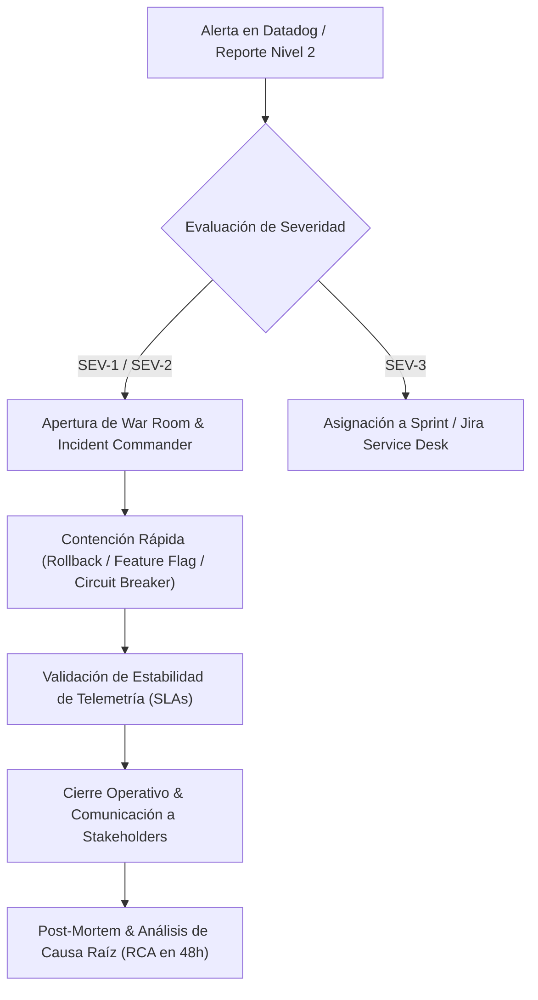

# 🛡️ Runbook de Gestión de Incidentes Críticos y SLAs 99%+

> **Autor:** Rosmar Mendoza — Ingeniera de Sistemas & Technical Project Manager  
> **Experiencia Base:** Operaciones en MercadoLibre y Fintech (Mo Technologies)

---

## 1. Matriz de Clasificación de Severidad

| Severidad | Definición de Impacto | SLA de Respuesta | SLA de Resolución (MTTR Objetivo) | Protocolo de Comunicación |
| :---: | :--- | :---: | :---: | :--- |
| **SEV-1 (Crítico)** | Caída total de servicios de pago o autenticación. Afectación masiva de usuarios (>10%). Pérdida transaccional directa. | **< 5 min** | **< 30 min** | War Room inmediato en Slack/Meet. Notificación a C-Level y Partners cada 15 min. |
| **SEV-2 (Alto)** | Degradación parcial de APIs críticas (latencia > 1.5s, tasa de error 5xx > 2%). Afectación a aliados bancarios. | **< 15 min** | **< 2 horas** | Canal de incidentes activo. Sincronización con Product Manager cada 30 min. |
| **SEV-3 (Medio)** | Error no bloqueante en funcionalidades secundarias. Existen *workarounds* para los usuarios. | **< 1 hora** | **< 24 horas** | Ticket priorizado en Jira Service Desk. Actualización en daily standup. |

---

## 2. Flujo de Respuesta a Incidentes (Paso a Paso)

### Paso 1: Detección y Contención Inmediata
1. **Identificar la causa aparente:** Revisar el último despliegue (CI/CD release) y métricas de error 5xx en Datadog.
2. **Priorizar la contención antes del debug:**
   * Si el incidente coincide con un release reciente: **Rollback inmediato** sin esperar análisis de código.
   * Si es degradación de un servicio aguas abajo: Activar **Feature Flag** o degradación controlada (*graceful degradation*).
3. **Rol del Technical PM:** Actuar como **Incident Commander**:
   * Blindar al equipo de ingeniería de interrupciones externas.
   * Manejar la comunicación ejecutiva y las expectativas de los aliados bancarios.

---

## 3. Plantilla de Análisis de Causa Raíz (RCA / Post-Mortem)

Todo incidente SEV-1 o SEV-2 requiere un Post-Mortem sin culpas (*Blameless Post-Mortem*) en un plazo no mayor a **48 horas**.

### 📋 Estructura del Documento RCA:

1. **Resumen Ejecutivo:**
   * *Fecha y Hora:* 2026-10-15 14:22 UTC - 14:48 UTC (Duración: 26 minutos).
   * *Servicios Afectados:* Microservicio de Pagos Golang / API Gateway.
   * *Impacto en SLA:* 0.04% de consumo de presupuesto de error (*Error Budget*).
2. **Cronología de Eventos (Timeline):**
   * `14:22` — Alerta automática de Datadog por pico de latencia P99 > 3.000 ms.
   * `14:25` — Apertura de War Room por Incident Commander (Rosmar Mendoza).
   * `14:31` — Se identifica saturación en el pool de conexiones de PostgreSQL por consulta no indexada.
   * `14:38` — Se aplica reinicio gradual de instancias y corte de tráfico no prioritario.
   * `14:45` — Latencia vuelve a niveles nominales (<120 ms). Tasa de error < 0.01%.
   * `14:48` — Incidente declarado resuelto.
3. **Los 5 Porqués (Root Cause Analysis):**
   * *¿Por qué cayó el servicio?* Por agotamiento de conexiones en la base de datos.
   * *¿Por qué se agotaron las conexiones?* Porque una consulta de reporte analítico bloqueó tablas transaccionales.
   * *¿Por qué corrió en la base transaccional?* Porque no estaba dirigida a la réplica de solo lectura (*read-replica*).
   * *¿Por qué no estaba configurada la réplica?* Falta de parámetro de configuración en la variable de entorno del pod.
   * *¿Por qué pasó desapercibido?* Ausencia de prueba de carga con alto volumen en Staging.
4. **Accionables Preventivos (Action Items con Dueño y Sprint):**
   * [ ] Configurar pool de réplica de lectura en microservicio de reportes `[Core Team - Sprint 43]`.
   * [ ] Crear alerta temprana de saturación de conexiones al 70% en Datadog `[DevOps - Inmediato]`.
   * [ ] Incorporar prueba de concurrencia obligatoria en el DoD `[QA Lead - Sprint 43]`.
