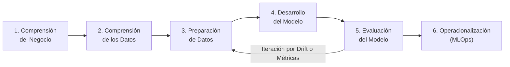

# 🧠 Caso de Estudio: Gestión Ágil de Proyectos de IA con Metodología CPMAI™ (PMI)

> **Autor:** Rosmar Mendoza — Ingeniera de Sistemas & Technical Project Manager  
> **Certificación:** Cognitive Project Management in AI (CPMAI)™ — *Project Management Institute (PMI)*

---

## 1. ¿Por qué el Software Tradicional Falla al Gestionar IA?

El desarrollo de software tradicional es **determinista** (código con lógica fija: si entra X, sale Y). En contraste, los proyectos de Inteligencia Artificial y Machine Learning son **probabilísticos y guiados por datos**.

El marco **CPMAI™ (Cognitive Project Management in AI)**, adoptado por el PMI, adapta el ciclo de vida ágil reconociendo la incertidumbre inherente de los modelos y datos, dividiendo el proyecto en **6 fases iterativas**:

---

## 2. Caso Práctico: Implementación de Modelo de Scoring Crediticio Asistido por IA

### 🎯 Fase 1: Comprensión del Negocio (Business Understanding)
* **Objetivo de Negocio:** Reducir el tiempo de pre-aprobación de crédito de 4 horas a menos de 5 minutos, manteniendo la tasa de impago (*default rate*) por debajo del **2.5%**.
* **Métrica de Éxito de Negocio:** Incremento del 35% en conversión de solicitudes sin elevar el riesgo crediticio.
* **Criterio de Viabilidad IA:** Se valida que el problema requiere patrones multivariables no lineales que un motor de reglas estático no puede resolver eficientemente.

### 📊 Fase 2 & 3: Comprensión y Preparación de Datos (Data Assessment)
* **Auditoría de Calidad:** Identificación de valores nulos, sesgos demográficos (*fairness check*) y cardinalidad en variables financieras.
* **Gobierno de Datos & Privacidad:** Anonimización de datos sensibles (PII) bajo estándares bancarios y hashing de identidades.
* **Feature Engineering:** Creación de variables de comportamiento de pago y recurrencia de ingresos mensuales.

### ⚙️ Fase 4 & 5: Modelado y Evaluación Rigurosa (Model Evaluation)
* **Métricas Técnicas Definidas por el PM:**
  * **ROC-AUC > 0.88** para discriminación entre buenos y malos pagadores.
  * **Recall > 92%** en detección de riesgo crediticio para minimizar pérdidas de capital.
* **Estrategia de Mitigación de Alucinaciones / Errores:**
  * Implementación de umbrales de confianza (*Confidence Thresholds*).
  * Solicitudes en zona gris (*Confidence Score* entre 0.45 y 0.60) se envían automáticamente a **revisión humana (Human-in-the-Loop)**.

### 🚀 Fase 6: Operacionalización y Monitoreo Continuo (MLOps)
* **Despliegue Progresivo:** Lanzamiento en Canary Release (10% de tráfico en semana 1, 50% en semana 2, 100% en semana 3).
* **Monitoreo de Data Drift:** Alarmas automáticas si la distribución de los datos de entrada en producción diverge de los datos de entrenamiento.
* **Gobernanza Ética:** Auditoría trimestral de equidad para asegurar que el modelo no genere discriminación involuntaria.

---

## 3. Rol del Technical PM en Proyectos de IA

1. **Evitar el "AI Washing":** Preguntar rigurosamente si se necesita IA o si una heurística simple es más barata y rápida.
2. **Gestionar la Incertidumbre:** Planificar sprints con *Spikes* de investigación y validación de datos antes de comprometer fechas de release a producción.
3. **Monitoreo de Costos (FinOps):** Supervisar el consumo de tokens y cómputo de inferencia en cloud para mantener el proyecto dentro del presupuesto operativo.
